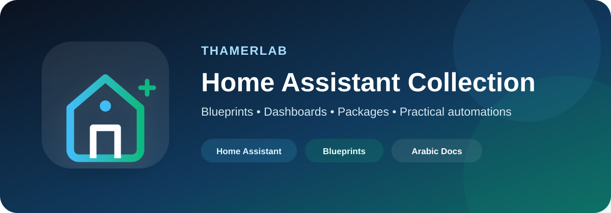
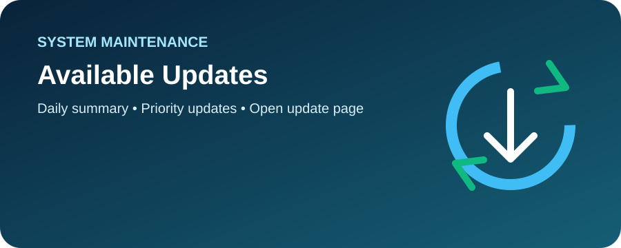
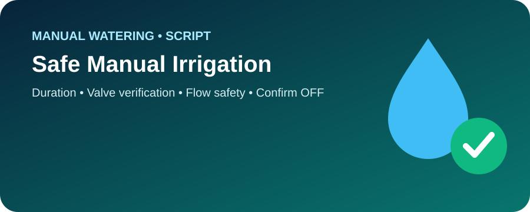

<div align="center">



<br>


**Reusable Home Assistant Blueprints with detailed English documentation, dedicated visuals, failure handling, and automated validation.**

[Blueprints](#-blueprints) · [Automation Catalog](./docs/AUTOMATION_CATALOG.md) · [Full Audit](./docs/AUDIT_2026-10-11.md) · [Installation](./docs/INSTALLATION.md) · [Validation](./docs/VALIDATION.md)

</div>

---

## 🎯 Repository Philosophy

This repository does not preserve a private copy of one home. Instead, it turns practical Home Assistant automations into **reusable public Blueprints**:

- No private entity IDs.
- No private IP addresses, tokens, or device IDs.
- Every Blueprint has its own step-by-step guide.
- Every Blueprint has its own dedicated image.
- Every wait has an explicit timeout.
- Hardware-facing automations include failure paths instead of assuming success.
- Changes must pass static validation and a real Home Assistant configuration check before they are merged.

> [!IMPORTANT]
> A green CI run proves that YAML, Blueprint structure, input expansion, documentation rules, and the Home Assistant configuration test all pass. It cannot guarantee that a physical Zigbee, Wi-Fi, AirPlay, water, or lighting device will respond perfectly in every real-world condition. Each hardware-facing Blueprint therefore includes a live-test checklist.

## 🧩 Blueprints

### 💧 Water & Irrigation

<table>
<tr>
<td width="50%" valign="top">


#### 🌱 Smart Irrigation

`smart_irrigation.yaml`

- Sunrise / Sunset / Custom / Fixed interval.
- Blocks a scheduled run if a selected valve is already ON.
- Verifies startup.
- Checks every selected flow sensor.
- Stops on no-flow.
- Detects early or manual shutdown.
- Verifies final OFF state.
- Estimates water usage from the sampled flow rate.

[📖 Detailed guide](./blueprints/automation/irrigation/SMART_IRRIGATION.md)

</td>
<td width="50%" valign="top">


#### 🚨 Long-running Water Safety

`long_running_water_safety.yaml`

- Alerts after a selected switch has remained ON too long.
- Critical notification support.
- Stop all / Keep running actions.
- Verifies OFF state after a stop command.
- Five-minute watchdog.
- Startup fallback.
- Unique actionable-notification IDs per run.

[📖 Detailed guide](./blueprints/automation/irrigation/WATER_SAFETY.md)

</td>
</tr>
</table>

### 📖 Quran / Music Assistant

<table>
<tr>
<td width="50%" valign="top">


#### 📖 Quran Sunrise & Sunset

`music_assistant_sunrise_sunset.yaml`

- Music Assistant player only.
- Exact library URI.
- `enqueue: replace`.
- Verifies `playing` plus the exact requested URI.
- Does not keep the automation running for the full recitation.

[📖 Detailed guide](./blueprints/automation/quran/SUNRISE_SUNSET.md)

</td>
<td width="50%" valign="top">


#### ▶️ Quran Safe Toggle Script

`music_assistant_quran_toggle.yaml`

- Same URI playing → Stop and verify.
- Same URI paused → Resume and verify.
- Different content → Replace queue, play, and verify.

[📖 Detailed guide](./blueprints/script/quran/README.md)

</td>
</tr>
</table>

### 🌙 Outdoor Lighting

<table>
<tr>
<td width="50%" valign="top">


#### 🌙 Dusk to Dawn

`outside_lights_dusk_dawn.yaml`

- Sun-elevation crossing.
- ON at dusk / OFF at dawn.
- Verifies the first command.
- Retries once.
- Sends a failure notification if the second attempt still cannot be confirmed.
- Does not force a state during Home Assistant startup.

[📖 Detailed guide](./blueprints/automation/lighting/DUSK_TO_DAWN.md)

</td>
<td width="50%" valign="top">


#### 💡 Abnormal State Alert

`outside_light_attention.yaml`

- Night + OFF / Day + ON mismatch detection.
- Configurable mismatch duration.
- Fix / Keep actions.
- Unique action IDs.
- Re-checks current conditions before applying Fix.

[📖 Detailed guide](./blueprints/automation/lighting/ABNORMAL_STATE_ALERT.md)

</td>
</tr>
</table>

### 🔔 System & Presence

<table>
<tr>
<td width="50%" valign="top">



#### 🔔 Available Updates

`available_updates_notification.yaml`

- Daily update check.
- Sends only when updates are available.
- User-selected priority update entities.
- Groups all remaining updates automatically.
- Opens the Home Assistant Updates page.

[📖 Detailed guide](./blueprints/automation/system/README.md)

</td>
<td width="50%" valign="top">


#### 📍 Zone Exit Notification

`notify_leaving_zone.yaml`

- Based on the official Home Assistant Zone Notification logic.
- Detects a selected person leaving a selected zone.
- Sends a Companion App notification.
- Intended for consent-based presence alerts.

[📖 Detailed guide](./blueprints/automation/presence/README.md)

</td>
</tr>
</table>

### 💧 Manual Irrigation Script

<p align="center">
  
</p>

#### 💧 Manual Irrigation — Safe Timed Run

`manual_irrigation_safe_run.yaml`

The runtime is requested each time the script is started. It includes startup verification, optional flow protection, early-stop detection, final OFF verification, and optional notifications.

[📖 Detailed guide](./blueprints/script/irrigation/README.md)

## 📚 Automation Catalog

For a single step-by-step explanation of every reusable automation and script:

**[docs/AUTOMATION_CATALOG.md](./docs/AUTOMATION_CATALOG.md)**

## 🚀 Import

Every detailed guide contains a direct Import button.

Manual import path:

```text
Home Assistant
→ Settings
→ Automations & Scenes
→ Blueprints
→ Import Blueprint
```

See the [Installation Guide](./docs/INSTALLATION.md).

## ✅ Validation

All relevant changes run:

`.github/workflows/validate-blueprints.yml`

The workflow checks YAML parsing, Blueprint metadata, `!input` integrity, wait timeouts, documentation/image coverage, SVG/XML validity, local links, privacy patterns, and Home Assistant `check_config`.

See [docs/VALIDATION.md](./docs/VALIDATION.md).

## 🔐 Security & Privacy

- Never commit `secrets.yaml`.
- Never commit tokens, passwords, API keys, or webhook secrets.
- Never hard-code private home entity IDs, device IDs, or LAN addresses in public Blueprints.
- Use location/presence automations only with appropriate consent.
- Test water and other physical-device automations under supervision before relying on them.

---

<div align="center">

Built and maintained by **ThamerLab**

</div>
