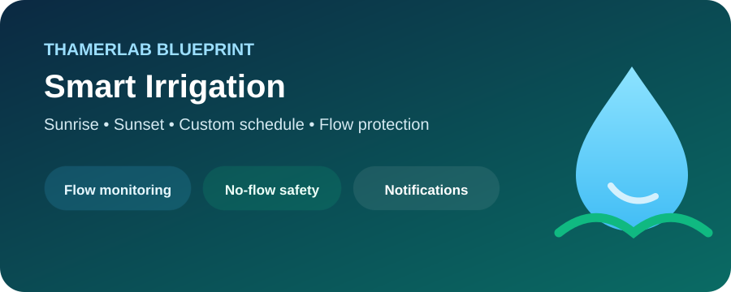
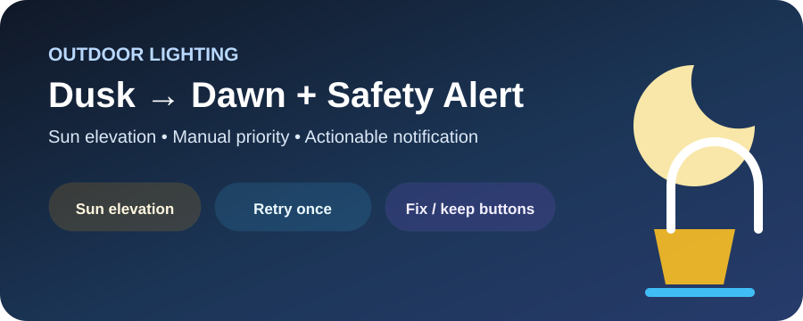

# 🧩 Blueprints

هذه صفحة الفهرس لجميع الـBlueprints القابلة لإعادة الاستخدام في المستودع.

  
  
  

## Automation Blueprints

| Blueprint | الاستخدام | الملف |
|---|---|---|
| 🌱 Smart Irrigation | جدولة سقاية + Flow + No-Flow + استهلاك تقديري | [YAML](./automation/irrigation/smart_irrigation.yaml) |
| 🚨 Long-running Water Safety | تنبيه Critical إذا بقي الماء/الصمام شغالًا | [YAML](./automation/irrigation/long_running_water_safety.yaml) |
| 📖 Quran Sunrise & Sunset | تشغيل Quran URI عبر Music Assistant عند الشروق والغروب | [YAML](./automation/quran/music_assistant_sunrise_sunset.yaml) |
| 🌙 Outdoor Lights — Dusk to Dawn | تشغيل/إطفاء حسب ارتفاع الشمس | [YAML](./automation/lighting/outside_lights_dusk_dawn.yaml) |
| 💡 Outdoor Light Attention | تنبيه Fix/Keep للحالة غير المعتادة | [YAML](./automation/lighting/outside_light_attention.yaml) |
| 📍 Zone Exit Notification | إشعار عند خروج Person من Zone | [YAML](./automation/presence/notify_leaving_zone.yaml) |

## Script Blueprints

| Blueprint | الاستخدام | الملف |
|---|---|---|
| 📖 Quran Safe Toggle | Stop / Resume / Replace Queue باستخدام Music Assistant | [YAML](./script/quran/music_assistant_quran_toggle.yaml) |

## التوثيق

- [🌱 Smart Irrigation](./automation/irrigation/README.md)
- [🚨 Water Safety](./automation/irrigation/WATER_SAFETY.md)
- [📖 Quran / Music Assistant](./automation/quran/README.md)
- [🌙 Outdoor Lighting](./automation/lighting/README.md)
- [📍 Zone Exit / Presence](./automation/presence/README.md)

## طريقة الاستيراد

1. افتح **Settings → Automations & Scenes → Blueprints**.
2. اختر **Import Blueprint**.
3. الصق رابط Raw للملف المطلوب.
4. أنشئ Automation أو Script واختر Inputs المناسبة.

> [!IMPORTANT]
> لا ترفع أسرارك أو Entity IDs الخاصة بمنزلك داخل ملفات Blueprint عامة.
