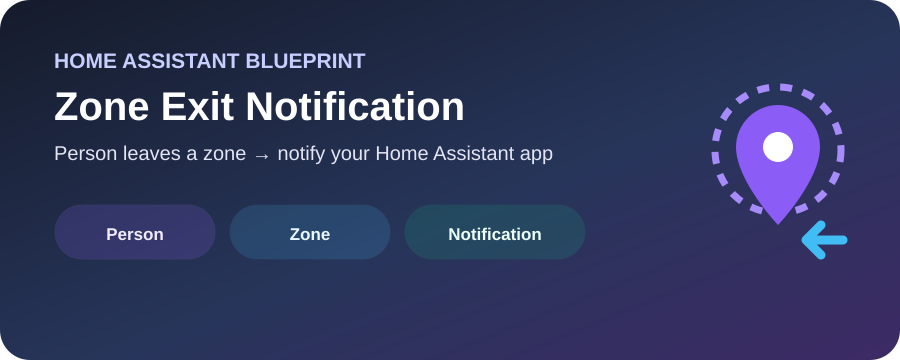

# Blueprints

  
  

هذا المجلد يجمع الـ **Blueprints القابلة للاستيراد مباشرة إلى Home Assistant** مع شرح عملي لكل واحد.

## المتوفر حاليًا

| Blueprint | الاستخدام | النوع | المسار |
|---|---|---|---|
| 🌱 Smart Irrigation | سقاية مجدولة مع مراقبة تدفق وحماية من انقطاع الماء | ThamerLab | `automation/irrigation/smart_irrigation.yaml` |
| 📍 Zone Exit Notification | إشعار عند خروج شخص من Zone محددة | Home Assistant (upstream) | `automation/presence/notify_leaving_zone.yaml` |

## طريقة الاستيراد

1. افتح **Settings → Automations & Scenes → Blueprints**.
2. اختر **Import Blueprint**.
3. الصق رابط الـRaw الخاص بالـBlueprint.
4. أنشئ Automation منه واختر الكيانات والأجهزة المناسبة.

> [!IMPORTANT]
> لا تضع أي مفاتيح API أو Tokens أو كلمات مرور أو بيانات شخصية داخل ملفات الـBlueprint العامة.

## التوثيق

- [Smart Irrigation](./automation/irrigation/README.md)
- [Zone Exit Notification](./automation/presence/README.md)
