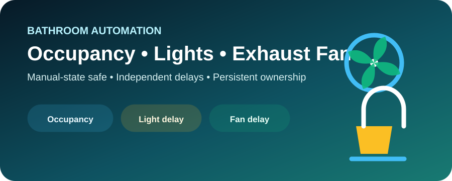

# 🚿 Bathroom Occupancy — Lights & Exhaust Fan

<p align="center">
  
</p>

File: `bathroom_occupancy_lights_fan.yaml`

This Blueprint is intentionally self-contained. **No helper entities are required.**

You only select:

- Occupancy / motion sensors.
- Bathroom lights.
- Exhaust fan targets.
- The timing and safety options you want.

Everything else is handled inside the Blueprint.

## What It Supports

- One or more occupancy/motion sensors.
- Aggregate occupancy: any sensor ON = occupied; all sensors OFF = vacant.
- Optional automatic light ON.
- Optional automatic fan ON.
- Independent Light ON and Fan ON delays.
- Independent Light OFF and Fan OFF delays.
- Forgotten-light safety timeout while the bathroom is already vacant.
- Forgotten-fan safety timeout while the bathroom is already vacant.
- Configurable startup and shutdown verification.
- Home Assistant startup reconciliation.
- Fan entities and relay-style switch entities.
- No ownership helper.
- No Toggle helper.
- No input_boolean setup.

## Inputs

| Input | Default | Purpose |
|---|---:|---|
| Occupancy / Motion Sensors | — | Any ON means occupied; all OFF means vacant |
| Bathroom Lights | — | Lights controlled by the Blueprint |
| Exhaust Fan | — | Fan or switch entities controlled by the Blueprint |
| Automatically Turn On Lights | ON | Enables occupancy-based automatic light startup |
| Automatically Turn On Fan | ON | Enables occupancy-based automatic fan startup |
| Light ON Delay | 0 sec | Occupancy duration required before lights start |
| Fan ON Delay | 0 sec | Occupancy duration required before fan starts |
| Light OFF Delay | 90 sec | Continuous vacancy before lights are turned OFF |
| Fan OFF Delay | 420 sec | Continuous vacancy before fan is turned OFF |
| Forgotten Light Safety | ON | Protects against a light being switched ON while the bathroom is already vacant |
| Forgotten Light Safety Timeout | 1800 sec | Maximum continuous vacant ON time before safety shutdown |
| Forgotten Fan Safety | ON | Protects against a fan being switched ON while the bathroom is already vacant |
| Forgotten Fan Safety Timeout | 3600 sec | Maximum continuous vacant ON time before safety shutdown |
| Startup Verification | 10 sec | Time allowed for automatic ON to be confirmed |
| Shutdown Verification | 15 sec | Time allowed for OFF to be confirmed |
| Home Assistant Startup Reconcile Delay | 30 sec | Delay before restoring OFF protection after HA starts |

## Step-by-Step Execution

### Step 1 — Aggregate Occupancy

The Blueprint combines all selected sensors into one logical bathroom state:

- **Occupied:** at least one selected sensor is ON.
- **Vacant:** every selected sensor is OFF.

A sensor becoming OFF while another sensor remains ON does not count as vacancy.

### Step 2 — Automatic Light Start

When the bathroom becomes occupied:

1. If automatic light startup is enabled, wait Light ON Delay.
2. Re-check that occupancy is still active.
3. Turn the selected lights ON.
4. Wait for every selected light to confirm ON.
5. If confirmation fails, create a persistent diagnostic notification.

Set Light ON Delay to 0 for immediate lighting.

### Step 3 — Automatic Fan Start

The fan works independently:

1. If automatic fan startup is enabled, wait Fan ON Delay.
2. Re-check occupancy.
3. Turn the fan targets ON.
4. Verify ON state.
5. Report a persistent diagnostic if startup is not confirmed.

A useful configuration is Light ON Delay = 0 and Fan ON Delay = 60 seconds, which prevents a very short bathroom visit from starting the exhaust fan.

### Step 4 — Normal Vacancy Shutdown

When every selected occupancy sensor becomes OFF, the Blueprint starts two independent timers in parallel:

- Light OFF Delay.
- Fan OFF Delay.

After each timer expires, the Blueprint checks that the bathroom is still fully vacant before sending OFF.

This means re-entering the bathroom before a timer expires prevents that shutdown.

### Step 5 — Manual ON During an Occupied Visit

If the user manually turns a selected light or fan ON while the bathroom is occupied, no special setup is needed.

Once the bathroom becomes fully vacant, the same normal Light OFF Delay or Fan OFF Delay applies.

The Blueprint intentionally treats the bathroom state as the source of truth instead of trying to track who pressed the ON button.

### Step 6 — Manual ON While the Bathroom Is Already Vacant

This is the forgotten-device protection.

If a selected light is ON while:

- The bathroom is fully vacant.
- Forgotten Light Safety is enabled.

the condition must remain true continuously for the Forgotten Light Safety Timeout. If occupancy does not return, the Blueprint turns the light OFF.

The fan uses the same design with its own independent safety timeout.

This protects against switching a light or fan ON manually and forgetting it.

### Step 7 — Returning Occupancy

If occupancy returns:

- The normal vacancy OFF actions re-check occupancy before changing devices.
- Forgotten-device safety template timers stop because the bathroom is no longer vacant.
- Automatic ON behavior can run again according to the configured ON delays.

The Blueprint uses `mode: parallel` so safety checks and independent device timers do not cancel one another.

### Step 8 — Home Assistant Restart

Active Home Assistant timers do not survive a restart.

The Blueprint includes a Home Assistant startup trigger:

1. Wait Home Assistant Startup Reconcile Delay.
2. Confirm the bathroom is fully vacant.
3. Start normal Light OFF and Fan OFF protection again.
4. If occupancy is active or any sensor is unknown/unavailable, no automatic startup-reconcile shutdown occurs.

## Why There Are No Helpers

The previous design used ownership helpers to distinguish between automation-started and manually started devices.

That is technically possible, but it makes setup harder and is not necessary for the desired bathroom behavior.

The simplified rule is easier to understand:

> **If the bathroom is occupied, keep the selected devices available according to the ON settings. If the bathroom is vacant, use the configured OFF timings. If something is manually switched ON while already vacant, the forgotten-device safety timeout protects against leaving it ON indefinitely.**

No extra entities are needed.

## Multiple Sensors

Multiple sensors are fully supported.

Example:

- Door-side motion sensor = OFF.
- Shower-area presence sensor = ON.

The bathroom remains Occupied because at least one sensor is still ON.

Only when **all** selected sensors are OFF does the normal vacancy cycle begin.

Unknown or unavailable sensors are not treated as OFF, which makes automatic shutdown conservative when occupancy information is uncertain.

## Suggested Starting Values

### Main Bathroom

- Light ON Delay: 0 sec.
- Fan ON Delay: 30–60 sec.
- Light OFF Delay: 90 sec.
- Fan OFF Delay: 420 sec.
- Forgotten Light Safety: 30 min.
- Forgotten Fan Safety: 60 min.

### Guest Bathroom

- Light ON Delay: 0 sec.
- Fan ON Delay: 60 sec.
- Light OFF Delay: 120 sec.
- Fan OFF Delay: 600 sec.
- Forgotten Light Safety: 30 min.
- Forgotten Fan Safety: 60 min.

These are starting points only. Every meaningful timing value is configurable.

## 100-case Logic Test

The repository runs:

`tests/test_bathroom_logic.py`

It executes exactly 100 deterministic scenarios covering:

- Automatic light enabled/disabled.
- Automatic fan enabled/disabled.
- Different ON delays.
- Different OFF delays.
- Different forgotten-device safety timeouts.
- Safety enabled/disabled.
- Manual pre-existing device states.
- Manual ON while vacant.
- Re-entry before shutdown.
- Home Assistant startup reconciliation.

## Safe Live-Test Checklist

1. Import the Blueprint.
2. Select the bathroom sensors, lights, and fan.
3. For the first test, use Light ON Delay = 0 and Fan ON Delay = 0.
4. Temporarily use Light OFF Delay = 10 sec and Fan OFF Delay = 20 sec.
5. Enter and confirm both devices start.
6. Leave and confirm they stop at the configured times.
7. Re-enter before a timer expires and confirm the pending shutdown does not turn the device OFF.
8. While the bathroom is vacant, manually turn the light ON and verify Forgotten Light Safety.
9. Repeat for the fan.
10. Restore your production timing values after supervised testing.

## Import

```text
https://raw.githubusercontent.com/ThamerLab/Home_Assistant/main/blueprints/automation/bathroom/bathroom_occupancy_lights_fan.yaml
```

[](https://my.home-assistant.io/redirect/blueprint_import/?blueprint_url=https%3A%2F%2Fraw.githubusercontent.com%2FThamerLab%2FHome_Assistant%2Fmain%2Fblueprints%2Fautomation%2Fbathroom%2Fbathroom_occupancy_lights_fan.yaml)
