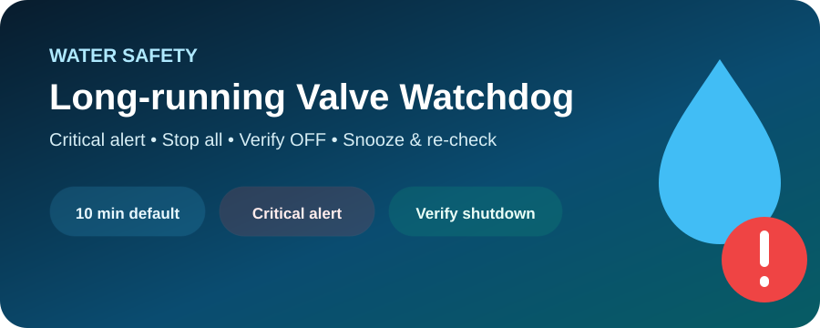

# 🚨 Long-running Water Safety Watchdog

<p align="center">
  
</p>

Blueprint مستقل عن جدول السقاية. وظيفته حماية إضافية إذا تُرك صمام ماء أو سقاية شغالًا مدة أطول من المتوقع.

## ماذا يفعل؟

- يراقب Switch واحد أو عدة Switches.
- التنبيه الافتراضي بعد **10 دقائق**.
- فحص احتياطي كل **5 دقائق** حتى بعد Restart/Reload.
- يرسل **Critical Notification** على الأجهزة التي تدعمها.
- زران:
  - 🛑 **Stop all**
  - 💧 **Keep running**
- عند Stop:
  - يرسل أمر إطفاء للجميع.
  - ينتظر حتى 15 ثانية.
  - لا يقول إن الإيقاف نجح إلا إذا أصبحت جميع الكيانات `off`.
  - إذا لم يتأكد، يرسل Critical failure.
- عند Keep:
  - يعمل Snooze افتراضي 30 دقيقة.
  - ثم يرجع الـWatchdog للمراقبة.

## لماذا هو Blueprint مستقل؟

حتى يعمل مع:

- صمامات سقاية.
- مضخات.
- Solenoid valves.
- أي مصدر مياه ممثل داخل Home Assistant كـ `switch`.

ولا يعتمد على Helpers خاصة بمنزل معين.

## Import

```text
https://raw.githubusercontent.com/ThamerLab/Home_Assistant/main/blueprints/automation/irrigation/long_running_water_safety.yaml
```

[](https://my.home-assistant.io/redirect/blueprint_import/?blueprint_url=https%3A%2F%2Fraw.githubusercontent.com%2FThamerLab%2FHome_Assistant%2Fmain%2Fblueprints%2Fautomation%2Firrigation%2Flong_running_water_safety.yaml)

> [!IMPORTANT]
> Home Assistant يستطيع فقط تأكيد أن حالة الكيان أصبحت `off`. التأكد من توقف الماء فعليًا يحتاج Flow Sensor أو تحقق مادي من الصمام.
