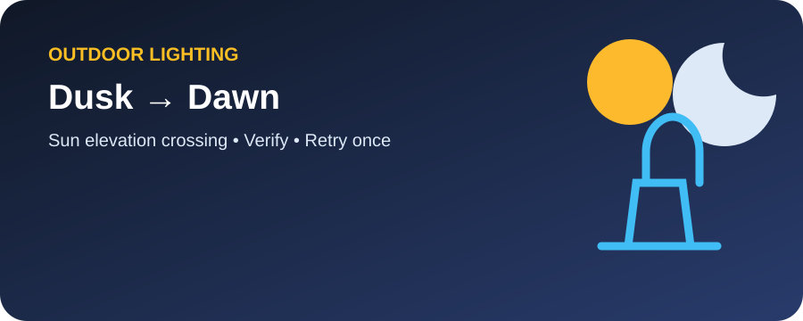
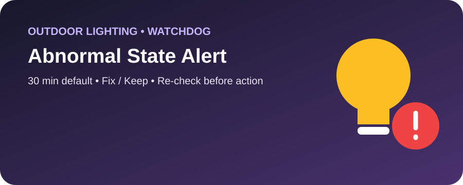

# 🌙 Outdoor Lighting Blueprints

  
  

هذا القسم يفصل **تنفيذ الجدول** عن **التنبيه على الاستثناء**.

## 1. 🌙 Outdoor Lights — Dusk to Dawn

الملف:
`outside_lights_dusk_dawn.yaml`

- ON عند عبور الشمس تحت Threshold.
- OFF عند عبورها فوق Threshold.
- تحقق من الحالة.
- Retry واحد.
- تنبيه إذا فشلت المحاولة الثانية.
- بدون Startup force-sync احترامًا للتحكم اليدوي.

[📖 الشرح التفصيلي](./DUSK_TO_DAWN.md)

## 2. 💡 Outdoor Light — Abnormal State Alert

الملف:
`outside_light_attention.yaml`

- يراقب Night + OFF أو Day + ON.
- ينتظر Mismatch Duration.
- يرسل Fix / Keep.
- يعيد فحص الظروف قبل تنفيذ Fix.
- Action IDs فريدة لكل Run.

[📖 الشرح التفصيلي](./ABNORMAL_STATE_ALERT.md)

الاثنان مصممان للعمل معًا بدون Loop يجبرك على وضع معين بعد تغييرك اليدوي.
