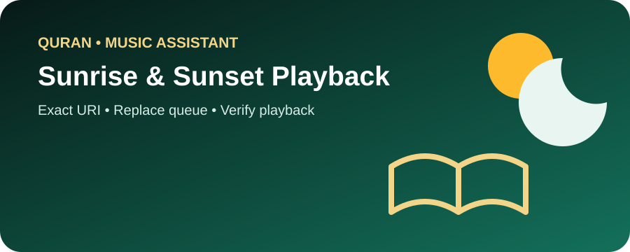
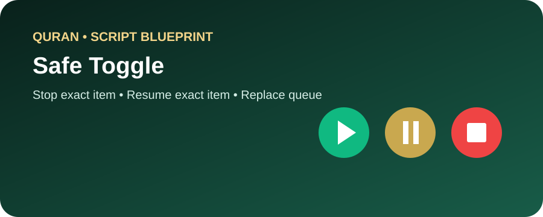

# 📖 Quran / Music Assistant Blueprints

  
  

الهدف هو جعل **Music Assistant طبقة التشغيل الوحيدة** للقرآن، وترك Home Assistant مسؤولًا عن الجدولة والمنطق.

## Automation: Sunrise & Sunset

`music_assistant_sunrise_sunset.yaml`

- تشغيل URI دقيق عند الشروق والغروب.
- `enqueue: replace`.
- تحقق `playing` + نفس `media_content_id`.
- Failure path واضح.
- لا ينتظر انتهاء التلاوة.

[📖 الشرح التفصيلي خطوة بخطوة](./SUNRISE_SUNSET.md)

## Script: Safe Toggle

`../../script/quran/music_assistant_quran_toggle.yaml`

- نفس URI Playing → Stop + Verify.
- نفس URI Paused → Resume + Verify.
- غير ذلك → Replace Queue + Play + Verify.
- MA-only player selector.

[📖 الشرح التفصيلي للسكريبت](../../script/quran/README.md)
